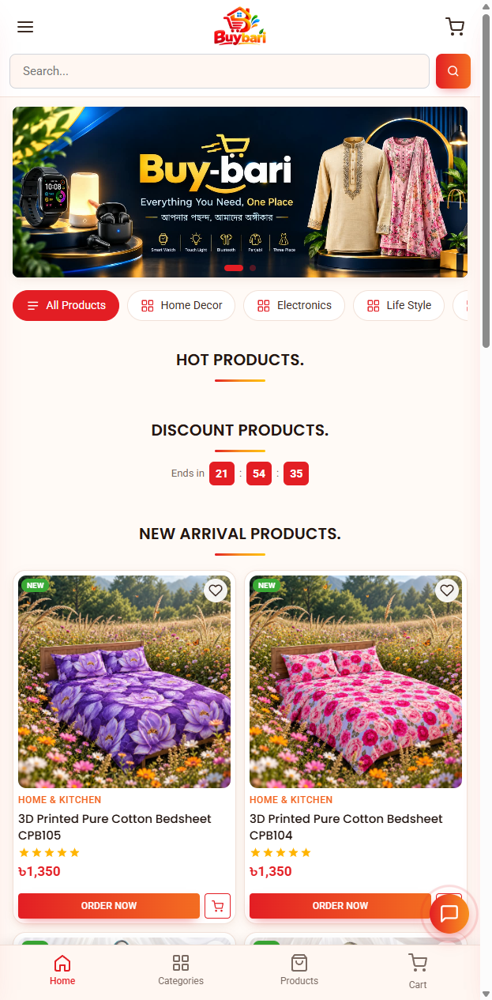
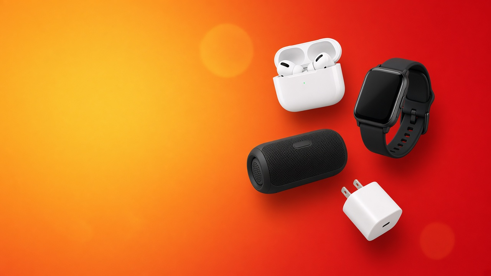

# Buybari

Online shopping for home decor, kitchen, gadgets, fashion and food, with delivery across Bangladesh and Cash on Delivery.

**Live site:** [buy-bari.com](https://buy-bari.com)

**Made by Tahsan Islam.** Copyright (c) Tahsan Islam.

Laravel-powered storefront with category browsing, product catalog, cart, wishlist, checkout, and an admin area for managing products and orders.

---

## Screenshots

### Homepage


### Category banner


### Sample product


---

## Stack

| Layer | Tech |
|-------|------|
| Storefront | HTML, CSS, JavaScript (root `*.html`, `css/`, `js/`, `images/`) |
| Backend | Laravel (API + admin under `app/`, `routes/`, `public/`) |
| Database | MySQL (`buybari.sql`) |
| Payments | Cash on Delivery and configured gateway options |

---

## Features

### Storefront
- Home hero slider and hot / discount / new arrival sections
- Category browsing (home decor, electronics, fashion, food, and more)
- Product cards with wishlist, add to cart, and Order Now
- Search, cart drawer, mobile bottom navigation
- About, Contact, Privacy, Terms, Refund, Payment policy pages
- Nationwide delivery messaging and COD support

### Backend / admin
- Product and category management
- Order and checkout handling
- Contact messages
- Site content editable for store operations

---

## Quick start (local)

**Requirements:** PHP 8.2+, Composer, MySQL

1. Create a MySQL database and import `buybari.sql`.
2. Configure `.env` (copy from a working env or create one with `APP_KEY`, DB credentials, and `APP_URL`).
3. Install dependencies and serve:

```bash
composer install
php artisan key:generate
php artisan serve
```

4. Open the storefront HTML (or the Laravel public entry, depending on your deploy layout) and `/admin` for the panel.

---

## Deploy (cPanel / BDIX hosting)

1. Create the MySQL database and import `buybari.sql`.
2. Upload the project files; run `composer install --no-dev` if needed.
3. Point the domain to the correct web root (`public/` for Laravel, or the folder that serves `index.html` for the HTML storefront).
4. Set `APP_URL=https://buy-bari.com` and production DB credentials in `.env`.
5. Ensure `storage/` and `bootstrap/cache/` are writable.

**Live domain:** https://buy-bari.com

---

## Project layout

```
index.html, about.html, contact.html, ...   Storefront pages
css/, js/, images/                          Front-end assets
app/, routes/, public/                      Laravel backend
buybari.sql                                 Database dump
docs/screenshots/                           README images
```
---

## Author and copyright

Everything in this project was designed and developed by **Tahsan Islam**.

Copyright (c) 2026 **Tahsan Islam**. All rights reserved.
